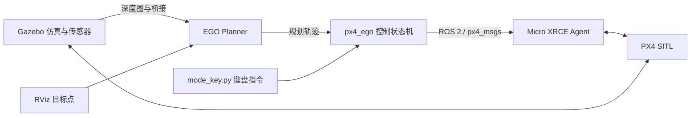
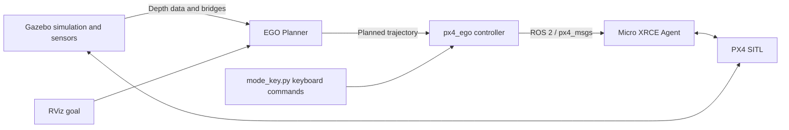

<a id="chinese"></a>

# EGO Planner 与 PX4 Gazebo 仿真实操指南

**中文** | [English](#english)

基于 Ubuntu 22.04、ROS 2 Humble、PX4 SITL 和 Gazebo Harmonic，记录 EGO Planner 避障规划与 PX4 Offboard 控制的集成流程。用于找回已有环境、核对工作空间，并按终端恢复启动步骤。

本仓库提供操作文档、原始手册、截图与演示视频。完整算法源码请参见文末参考项目；本仓库不包含虚拟机镜像或已编译工作空间。整理期间未重新运行仿真，演示材料来自原实操记录。

## 实操画面


截图提取自原手册末页。画面展示了仿真环境和运行界面，不作为当前环境已经恢复成功的验证结果。

## 从这里开始

1. [环境与现有项目恢复](docs/recovery.md)：确认文件、依赖与已有编译产物。
2. [按终端启动流程](docs/operation.md)：集成入口、控制状态机、键盘操作、规划器和 RViz。
3. [问题排查与手册修正](docs/troubleshooting.md)：重复启动、话题筛选、启动入口差异。
4. [原始 Markdown 手册](source/ego_simulation.md) · [原始 PDF](source/ego_simulation.pdf)。

## 系统关系



## 原手册记录的环境

| 组件 | 记录 |
|---|---|
| 操作系统 | Ubuntu 22.04 |
| ROS | ROS 2 Humble |
| 飞控 | PX4 Firmware ≥ 1.14.0；实际提交版本未记录 |
| 仿真器 | Gazebo Harmonic |
| 通信 | Micro XRCE Agent、px4_msgs |
| 控制层 | px4_ego / px4_ego_py |
| 规划 | ego-swarm-ros2，ROS 包名 ego_planner |
| 集成入口 | ego-planner-ros2-sim 中的 px4_sitl_ros2.launch.py |

这些版本来自原记录，不表示任意新版本组合都已验证。

## 启动速查

先确认原工作空间和脚本存在。每个新终端先加载环境：

```bash
source /opt/ros/humble/setup.bash
source ~/planner_ws/install/setup.bash
```

以下各组分别在独立终端执行，仅作为以后操作参考：

**终端 1：集成入口**

```bash
cd ~/PX4-Autopilot
ros2 launch ./launch/px4_sitl_ros2.launch.py
```

已检查的本地压缩包版本包含 MAVROS、Gazebo、PX4 实例 0、MicroXRCEAgent 和深度图桥接。先核对虚拟机内的启动文件；若逻辑一致，不重复单独启动 Gazebo 和 Agent。原记录预期模型名为 `x500_depth_0`。

**终端 2：控制状态机**

```bash
ros2 run px4_ego_py offboard_control_test
```

**终端 3：键盘控制**

```bash
cd ~/planner_ws/src/px4_ego
python3 mode_key.py
```

原记录使用 `t` 起飞，稳定悬停后按 `o` 请求 Offboard。以当前脚本按键定义和飞控反馈为准，按下按键不代表切换一定成功。

**终端 4：EGO Planner**

```bash
ros2 launch ego_planner single_uav_gazebo.launch.py
```

原记录建议 PX4 启动约 25 秒后启动规划器，这是当时的经验时间，仍需确认状态与传感器数据就绪。`single_run_in_sim.launch.py` 的用途在原记录中尚未明确，不纳入这条主流程。

**终端 5：RViz**

```bash
ros2 launch ego_planner rviz.launch.py
```

使用原记录中的 `2D Goal Pose` 设置目标；工具名称、目标话题和 Fixed Frame 以实际 RViz 配置为准。

## 常用检查

```bash
gz model --list
sudo lsof -i UDP:8888
ros2 node list
ros2 topic list | grep '/fmu/'
ros2 topic echo /fmu/out/vehicle_local_position --once
```

这里用 `grep '/fmu/'` 修正原文无法匹配示例话题的 `grep px4`。端口监听不等于通信链路已经正常；等待消息的命令可用 Ctrl+C 结束。

## 演示视频

- [2026-07-23 19-21-43 原始演示](assets/videos/2026-07-23%2019-21-43.mp4)
- [2026-07-23 19-26-37 原始演示](assets/videos/2026-07-23%2019-26-37.mp4)

日期沿用原文件名；网页无法内嵌播放时可下载观看。GitHub 版本压缩转码以便浏览，未剪辑时间线；本地发布包保留原视频。

## 参考项目与归属

本项目是基于既有开源项目的实操整理，不将上游算法和控制代码声明为原创。

- [ego-planner-ros2-sim](https://github.com/DongnanHu6556/ego-planner-ros2-sim)：集成仿真说明及启动入口。
- [px4_ego](https://github.com/DongnanHu6556/px4_ego)：PX4 与规划器之间的控制层。
- [ego-swarm-ros2](https://github.com/DongnanHu6556/ego-swarm-ros2)：规划器参考仓库。

参考链接来自本地项目压缩包 README，未锁定上游提交。上游代码遵循各自许可证；本仓库暂未另行授予文档和媒体的开源许可。

---

<a id="english"></a>

# EGO Planner with PX4 and Gazebo Simulation Guide

[中文](#chinese) | **English**

A practical guide to integrating EGO Planner obstacle avoidance with PX4 Offboard control using Ubuntu 22.04, ROS 2 Humble, PX4 SITL, and Gazebo Harmonic. It documents how to recover an existing setup, check the workspace, and restore the terminal-by-terminal startup sequence.

This repository contains operating instructions, the original notes, screenshots, and demonstration videos. Refer to the upstream projects below for the algorithm and controller source code. Virtual machine images and compiled workspaces are not included. The simulation was not rerun while preparing these documents; the media comes from the original practical work.

## Screenshots


The screenshots were extracted from the final page of the original notes. They illustrate the recorded environment and interfaces, rather than verify that the current setup has been restored successfully.

## Getting started

The detailed guides and original notes below are currently in Chinese. This README provides a bilingual overview and an English startup reference.

1. [Environment and workspace recovery](docs/recovery.md): check paths, dependencies, and existing build artifacts.
2. [Terminal-by-terminal operation](docs/operation.md): integrated launch, controller, keyboard commands, planner, and RViz.
3. [Troubleshooting and corrections](docs/troubleshooting.md): duplicate processes, topic filtering, and launch-file differences.
4. [Original Markdown notes](source/ego_simulation.md) · [Original PDF](source/ego_simulation.pdf).

## System overview



## Environment recorded in the notes

| Component | Recorded setup |
|---|---|
| Operating system | Ubuntu 22.04 |
| ROS | ROS 2 Humble |
| Flight controller | PX4 Firmware ≥ 1.14.0; exact commit not recorded |
| Simulator | Gazebo Harmonic |
| Communication | Micro XRCE Agent and px4_msgs |
| Control layer | px4_ego / px4_ego_py |
| Planner | ego-swarm-ros2; ROS package: ego_planner |
| Integrated entry point | px4_sitl_ros2.launch.py from ego-planner-ros2-sim |

These are the versions recorded during the original work, not a claim that every newer version combination has been tested.

## Startup reference

First verify that the original workspace and required scripts exist. In each new terminal, load the ROS environment and workspace overlay:

```bash
source /opt/ros/humble/setup.bash
source ~/planner_ws/install/setup.bash
```

Use separate terminals for the following commands. This is a reference for future execution, not a record of commands run during document preparation.

**Terminal 1 — Integrated simulation entry point**

```bash
cd ~/PX4-Autopilot
ros2 launch ./launch/px4_sitl_ros2.launch.py
```

The copy examined in the local project archive already launches MAVROS, Gazebo, PX4 instance 0, MicroXRCEAgent, and depth-image bridges. If the VM's launch file matches it, do not start Gazebo or the Agent a second time. Check the actual launch file before relying on this behavior. The recorded model name is `x500_depth_0`.

**Terminal 2 — Control state machine**

```bash
ros2 run px4_ego_py offboard_control_test
```

**Terminal 3 — Keyboard control**

```bash
cd ~/planner_ws/src/px4_ego
python3 mode_key.py
```

The original notes use `t` for takeoff, then `o` to request Offboard after stable hovering. Confirm the current script's key bindings and the flight controller's response; a key press alone does not prove that a mode change succeeded.

**Terminal 4 — EGO Planner**

```bash
ros2 launch ego_planner single_uav_gazebo.launch.py
```

The notes suggest waiting about 25 seconds after starting PX4. Treat this as an observation from the original setup, and also verify that state and sensor data are ready. The purpose of `single_run_in_sim.launch.py` was left unresolved in the original notes; it is not included in this main workflow.

**Terminal 5 — RViz**

```bash
ros2 launch ego_planner rviz.launch.py
```

Use the goal-setting tool recorded as `2D Goal Pose` to select a target. Confirm the tool, target topic, and Fixed Frame against the actual RViz configuration.

## Useful checks

```bash
gz model --list
sudo lsof -i UDP:8888
ros2 node list
ros2 topic list | grep '/fmu/'
ros2 topic echo /fmu/out/vehicle_local_position --once
```

Filtering with `grep '/fmu/'` corrects the original `grep px4` example, which would not match the listed `/fmu/...` topics. A listening UDP port does not by itself prove that data is flowing. Use Ctrl+C to stop a command waiting for a message.

## Demonstration videos

- [Original demo — 2026-07-23 19-21-43](assets/videos/2026-07-23%2019-21-43.mp4)
- [Original demo — 2026-07-23 19-26-37](assets/videos/2026-07-23%2019-26-37.mp4)

Dates come from the original filenames. Download the videos if inline playback is unavailable. The GitHub copies are transcoded for web viewing without timeline edits; the local release package retains the original videos.

## References and attribution

This repository documents practical work based on existing open-source projects. It does not claim authorship of the upstream planning algorithms or control code.

- [ego-planner-ros2-sim](https://github.com/DongnanHu6556/ego-planner-ros2-sim): simulation integration and launch entry point.
- [px4_ego](https://github.com/DongnanHu6556/px4_ego): control layer connecting the planner to PX4.
- [ego-swarm-ros2](https://github.com/DongnanHu6556/ego-swarm-ros2): planner reference repository.

These links come from the README in the local project archive; upstream commits are not pinned. Upstream code retains its respective licenses. No additional open-source license has been granted for the documentation and media in this repository.
