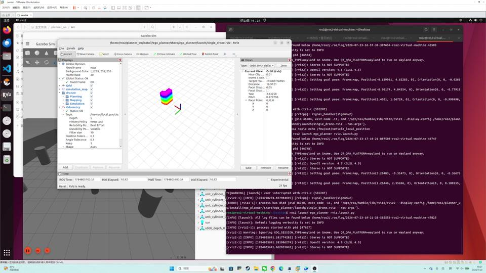
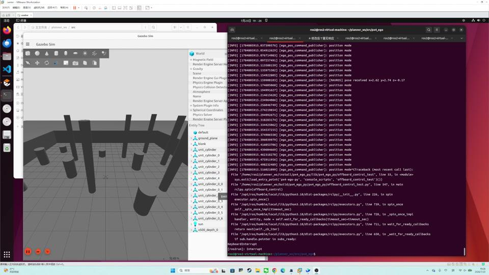

# EGO Planner + PX4 + Gazebo：虚拟机源码与实操资料

[中文](#中文) | [English](#english)

## 中文

本仓库已补入从原 VMware 虚拟磁盘只读导出的实际项目源码，包含 EGO Planner C++ 实现、Python 控制状态机、ROS 消息、构建文件、启动脚本和 Gazebo 场景配置。源码保留虚拟机内的修改，不是重新下载上游仓库。

### 源码入口

| 路径 | 内容 |
|---|---|
| [workspace/src/ego-swarm-ros2](workspace/src/ego-swarm-ros2) | 主规划器、B-spline 优化、地图、轨迹服务器、内部模拟器、px4_msgs |
| [workspace/src/px4_ego](workspace/src/px4_ego) | Python 控制状态机、mode_key.py |
| [workspace/src/ego_planner_ros_humble-main](workspace/src/ego_planner_ros_humble-main) | 虚拟机内另一套规划项目，包括 bridge_test、new_pkg 来源 |
| [workspace/src/ego-planner-ros2-sim](workspace/src/ego-planner-ros2-sim) | 原集成项目及其脚本 |
| [simulation](simulation) | 实际 PX4 启动配置、Gazebo 脚本、worlds、x500_depth 及依赖模型 |
| [SOURCE_MANIFEST.json](SOURCE_MANIFEST.json) | 原磁盘路径、文件模式、大小及 SHA-256 |

`workspace/src` 保留 Linux 软链接，原先指向 `/home/ros2/...` 的工作空间内部链接已改为相对链接。两个原始项目目录内的 COLCON_IGNORE 原样保留；构建使用顶层包链接。请在 Linux 上用 Git 克隆，GitHub 的 ZIP 下载不保证还原软链接语义。

原始网格、纹理、模型缩略图和依赖库插图集中保存在 [resources/model-assets.tar.xz](resources/model-assets.tar.xz)，路径清单见 [asset-paths.json](resources/asset-paths.json)。在仓库根目录运行一次恢复程序，它不会覆盖内容不同的现有文件：

```bash
python3 restore_assets.py
```

### 编译与部署边界

本仓库包含规划工作空间源码；PX4-Autopilot 完整源码、系统 ROS/Gazebo、MAVROS、Micro XRCE Agent 和编译产物仍需已有环境提供。PX4 的实际定制 launch 文件在 `simulation/px4/`。未在本次导出中重新编译或执行仿真。

在装好对应依赖的 Ubuntu 22.04 / ROS 2 Humble 环境中，可从源码目录编译：

```bash
source /opt/ros/humble/setup.bash
cd workspace
colcon build --symlink-install
source install/setup.bash
```

原启动代码仍使用 `~/PX4-Autopilot`、`~/ros_proj/gazebo_start` 和 `~/.simulation-gazebo` 等路径。迁移时需将 `simulation/px4`、`simulation/gazebo_start`、`simulation/worlds`、`simulation/models`、`simulation/server.config` 对应部署到这些位置，先备份已有修改。克隆本仓库本身不会自动安装飞控或配置这些目录。

### 当前实际启动方式

每个终端先 source ROS 和编译后的工作空间。以下分别在四个终端执行：

```bash
# 终端 1：Gazebo/PX4/通信桥；25 秒后启动规划器
ros2 launch ego_planner run_px4_ego.launch.py

# 终端 2：控制状态机
ros2 run px4_ego_py offboard_control_test

# 终端 3：在仓库根目录执行键盘节点
python3 workspace/src/px4_ego/mode_key.py

# 终端 4：RViz
ros2 launch ego_planner rviz.launch.py
```

- 键盘节点使用 input()：输入 `t` 或 `o` 后必须按回车。
- 当前 `t` 分支包含解锁、请求 Offboard 和起飞悬停，标准定位分支目标 z=-0.9（NED）。
- `o` 分支等待或跟随规划轨迹，并检查飞控状态。计时和日志不能替代飞控状态验证。
- 集成入口已包括规划器，勿重复运行另一份 PX4 或规划器入口。
- PX4 内部延迟 8 秒启动，世界为 ego，SYS_AUTOSTART=4002，MAVROS 目标端口为 14580。
- `single_run_in_sim.launch.py` 是内部模拟器路线，不是 PX4/Gazebo 主流程的附加步骤。

### 文档和演示

[实际源码核对记录](docs/vm-source-findings.md) · [原操作说明](docs/operation.md) · [环境恢复](docs/recovery.md) · [问题排查](docs/troubleshooting.md) · [原手册](source/ego_simulation.md) · [PDF](source/ego_simulation.pdf)




[演示一](assets/videos/2026-07-23%2019-21-43.mp4) · [演示二](assets/videos/2026-07-23%2019-26-37.mp4)。视频为原实操记录的压缩版，未剪辑时间线。

## English

This repository now includes the actual project source extracted read-only from the original VMware disk: EGO Planner C++, Python control code, ROS messages, build files, launch scripts and Gazebo configuration. Local VM changes are preserved instead of replacing them with fresh upstream downloads.

Browse `workspace/src` for the planner and controller code, and `simulation` for the actual PX4 launch, Gazebo scripts, worlds and the x500_depth model dependency chain. Linux symlinks are preserved; absolute links within the workspace are converted to relative links. Use Git on Linux rather than relying on GitHub ZIP symlink behavior.

Original meshes, textures, model thumbnails and dependency illustrations are included in `resources/model-assets.tar.xz`. Run `python3 restore_assets.py` at the checkout root to restore their original paths. The script refuses to replace existing files with different contents.

On a configured Ubuntu 22.04 / ROS 2 Humble system, source ROS, enter `workspace`, run `colcon build --symlink-install`, then source `install/setup.bash`. Full PX4-Autopilot, ROS/Gazebo, MAVROS and Micro XRCE Agent remain external dependencies. No build or simulation was run during extraction. Original launch files still expect `~/PX4-Autopilot`, `~/ros_proj/gazebo_start` and `~/.simulation-gazebo`; deploy the corresponding `simulation` files there after backing up local changes.

Use `run_px4_ego.launch.py` for the integrated simulation and planner, followed by the Python controller, keyboard node and RViz in separate terminals as shown above. Enter a letter and press Enter. The current `t` branch already requests Offboard and commands takeoff/hover; `o` waits for or follows planner commands. The planner is started after a fixed 25-second delay; PX4 uses an 8-second delay. These timers are not readiness checks.

## 来源与许可证 / Attribution and licenses

Upstream references: [ego-swarm-ros2](https://github.com/DongnanHu6556/ego-swarm-ros2), [px4_ego](https://github.com/DongnanHu6556/px4_ego), [ego-planner-ros2-sim](https://github.com/DongnanHu6556/ego-planner-ros2-sim).

保留各目录原有 LICENSE、版权声明和 package.xml 许可信息，不将上游算法声明为原创，不对整仓库统一重新授权。Preserved upstream licenses and notices apply to their respective components; this repository does not claim original authorship of upstream algorithms or impose a new blanket license.
